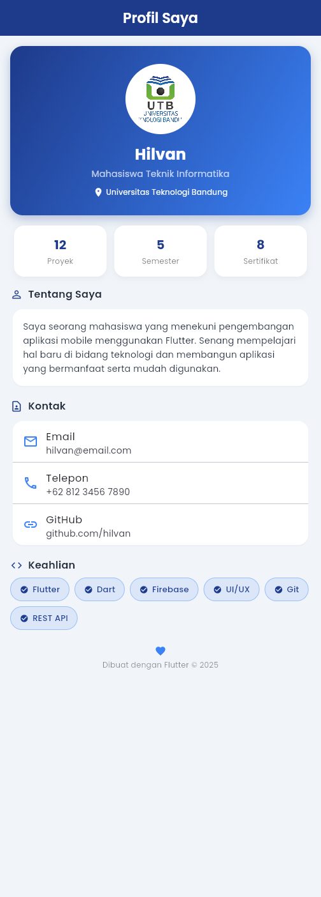

# Pemrograman Mobile II – Profile App

Repository ini dibuat untuk memenuhi tugas mata kuliah **Pemrograman Mobile II** di **UTB**.

Aplikasi berupa halaman profil sederhana yang dibangun menggunakan **Flutter** (Material 3) dengan font custom **Poppins** dan logo UTB.

## Screenshot

Screenshot aplikasi tersedia di dalam folder [`screenshots/`](screenshots/).



## Struktur Proyek

```
lib/main.dart        # Kode utama aplikasi (tema global & halaman profil)
assets/              # Logo UTB dan font Poppins
screenshots/         # Screenshot hasil aplikasi
```

## Cara Menjalankan

1. Pastikan Flutter SDK sudah terpasang.
2. Clone repository ini:
   ```bash
   git clone https://github.com/HilvanYadhisnata/PemrogramanMobile-II.git
   cd PemrogramanMobile-II
   ```
3. Install dependency:
   ```bash
   flutter pub get
   ```
4. Jalankan aplikasi:
   ```bash
   flutter run
   ```

## Author

**Hilvan Yadhisnata** – Pemrograman Mobile II, UTB
